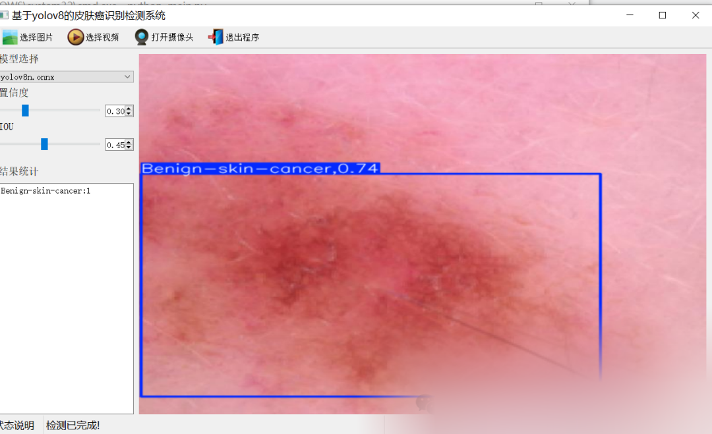
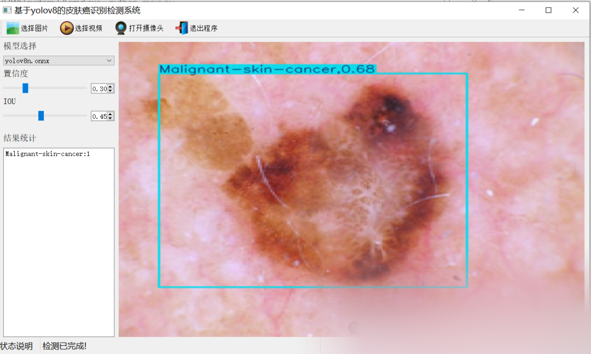
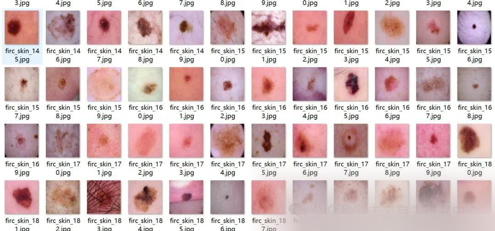
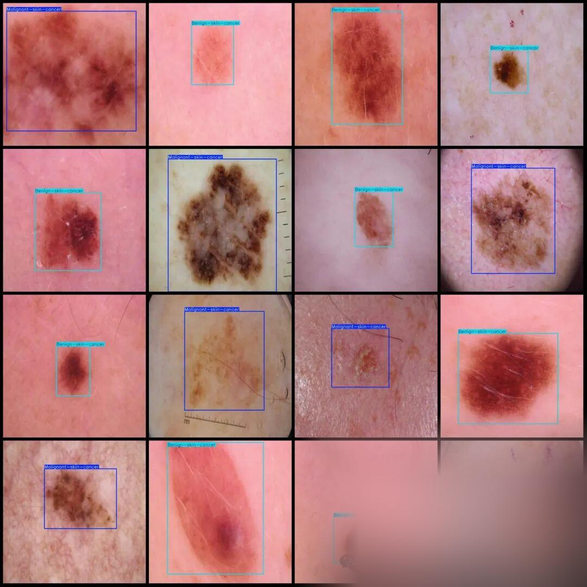

# Skin Cancer Detection System Based on Yolov8 in Python Source Code + ONNX Model + Evaluation Indicator Curve + High-quality GUI Interface

[Algorithm Introduction]The skin cancer detection system based on YOLOv8 is an intelligent diagnostic tool that integrates deep learning with medical image analysis technology. It is specifically designed to identify benign skin conditions.

[Algorithm Introduction]

A skin cancer detection system based on YOLOv8 is an intelligent diagnostic tool that integrates deep learning with medical image analysis technology, specifically designed to identify benign (benign) and malignant (malignant) skin cancer. The system uses the YOLOv8 object detection algorithm to perform real-time analysis of skin microscope images or clinical photographs, accurately pinpointing and classifying abnormal areas. Its core functions include:

1.

1. Real-time detection capability

Supports image, video, and camera input, capable of quickly outputting detection boxes and category information, suitable for clinical screening and remote diagnosis scenarios.

1.

1. **High Precision and Generalization**

Based on training with over 3000 images, the model achieves an accuracy above 80% on the test set.

1.

1. **User-friendly interface**

Integrates PyQt5 framework to provide a visual operation interface, supports parameter adjustment (such as confidence threshold), and results display, facilitating physicians' assistance in diagnosis.
The system effectively reduces the misdiagnosis rate through deep learning target detection technology, enhances early screening efficiency, and provides an intelligent solution for skin cancer diagnosis and treatment.

[Effect Display]

Editor

Editor

[Test Environment]

windows10
anaconda3+python3.8
torch==2.3.0
ultralytics==8.3.81

The model can detect 2 categories.

Benign-skin-cancer (benign skin cancer)
Malignant-skin-cancer (malignant skin cancer)

[Training Dataset Introduction]

Dataset format: Pascal VOC format + YOLO format (txt file without split path, only contains jpg images and corresponding VOC format xml files and yolo format txt files)

Number of images (number of jpg files): 3296

Number of annotations (number of xml files): 3296

Number of annotations (number of txt files): 3296

Labeling category count: 2

Label category names (note that the order of yolo format categories does not correspond to this, but is based on the classes.txt in the labels folder): ["Benign-skin-cancer", "Malignant-skin-cancer"]

Number of boxes labeled in each category:

Benign-skin-cancer Frame Count = 1998

Malignant-skin-cancer Frame Count = 1764

Total frames: 3762

Using labelImg:

Annotation rules: Draw a rectangle around the category.

Important Notice: No

Special : This dataset does not guarantee the accuracy or precision of the trained models or weight files. The dataset is provided with accurate and reasonable annotations only.

Image Preview:

Editor

Annotation example:

Editor

[Training Information]


Parameters


Value


Number of training set images


2307


Number of images in the validation set


659


Training map


83.9%


Training Accuracy


82.6%


Training recall rate


74.9%


[Verification set accuracy]


Category


MAP50


all


84


Benign-skin-cancer


92


Malignant-skin-cancer


76


[Interface Design]

```
class Ui_MainWindow(QtWidgets.QMainWindow):
signal = QtCore.pyqtSignal(str, str)
def setupUi(self):
self.setObjectName("MainWindow")
self.resize(1280, 728)
self.centralwidget = QtWidgets.QWidget(self)
self.centralwidget.setObjectName("centralwidget")
self.weights_dir = './weights'
self.picture = QtWidgets.QLabel(self.centralwidget)
self.picture.setGeometry(QtCore.QRect(260, 10, 1010, 630))
self.picture.setStyleSheet("background:black")
self.picture.setObjectName("picture")
self.picture.setScaledContents(True)
self.label_2 = QtWidgets.QLabel(self.centralwidget)
self.label_2.setGeometry(QtCore.QRect(10, 10, 81, 21))
self.label_2.setObjectName("label_2")
self.cb_weights = QtWidgets.QComboBox(self.centralwidget)
self.cb_weights.setGeometry(QtCore.QRect(10, 40, 241, 21))
self.cb_weights.setObjectName("cb_weights")
self.cb_weights.currentIndexChanged.connect(self.cb_weights_changed)
self.label_3 = QtWidgets.QLabel(self.centralwidget)
self.label_3.setGeometry(QtCore.QRect(10, 70, 72, 21))
self.label_3.setObjectName("label_3")
self.hs_conf = QtWidgets.QSlider(self.centralwidget)
self.hs_conf.setGeometry(QtCore.QRect(10, 100, 181, 22))
self.hs_conf.setProperty("value", 25)
self.hs_conf.setOrientation(QtCore.Qt.Horizontal)
self.hs_conf.setObjectName("hs_conf")
self.hs_conf.valueChanged.connect(self.conf_change)
self.dsb_conf = QtWidgets.QDoubleSpinBox(self.centralwidget)
self.dsb_conf.setGeometry(QtCore.QRect(200, 100, 51, 22))
self.dsb_conf.setMaximum(1.0)
self.dsb_conf.setSingleStep(0.01)
self.dsb_conf.setProperty("value", 0.25)
self.dsb_conf.setObjectName("dsb_conf")
self.dsb_conf.valueChanged.connect(self.dsb_conf_change)
self.dsb_iou = QtWidgets.QDoubleSpinBox(self.centralwidget)
self.dsb_iou.setGeometry(QtCore.QRect(200, 160, 51, 22))
self.dsb_iou.setMaximum(1.0)
self.dsb_iou.setSingleStep(0.01)
self.dsb_iou.setProperty("value", 0.45)
self.dsb_iou.setObjectName("dsb_iou")
self.dsb_iou.valueChanged.connect(self.dsb_iou_change)
self.hs_iou = QtWidgets.QSlider(self.centralwidget)
self.hs_iou.setGeometry(QtCore.QRect(10, 160, 181, 22))
self.hs_iou.setProperty("value", 45)
self.hs_iou.setOrientation(QtCore.Qt.Horizontal)
self.hs_iou.setObjectName("hs_iou")
self.hs_iou.valueChanged.connect(self.iou_change)
self.label_4 = QtWidgets.QLabel(self.centralwidget)
self.label_4.setGeometry(QtCore.QRect(10, 130, 72, 21))
self.label_4.setObjectName("label_4")
self.label_5 = QtWidgets.QLabel(self.centralwidget)
self.label_5.setGeometry(QtCore.QRect(10, 210, 72, 21))
self.label_5.setObjectName("label_5")
self.le_res = QtWidgets.QTextEdit(self.centralwidget)
self.le_res.setGeometry(QtCore.QRect(10, 240, 241, 400))
self.le_res.setObjectName("le_res")
self.setCentralWidget(self.centralwidget)
self.menubar = QtWidgets.QMenuBar(self)
self.menubar.setGeometry(QtCore.QRect(0, 0, 1110, 30))
self.menubar.setObjectName("menubar")
self.setMenuBar(self.menubar)
self.statusbar = QtWidgets.QStatusBar(self)
self.statusbar.setObjectName("statusbar")
self.setStatusBar(self.statusbar)
self.toolBar = QtWidgets.QToolBar(self)
self.toolBar.setToolButtonStyle(QtCore.Qt.ToolButtonTextBesideIcon)
self.toolBar.setObjectName("toolBar")
self.addToolBar(QtCore.Qt.TopToolBarArea, self.toolBar)
self.actionopenpic = QtWidgets.QAction(self)
icon = QtGui.QIcon()
icon.addPixmap(QtGui.QPixmap(":/images/1.png"), QtGui.QIcon.Normal, QtGui.QIcon.Off)
self.actionopenpic.setIcon(icon)
self.actionopenpic.setObjectName("actionopenpic")
self.actionopenpic.triggered.connect(self.open_image)
self.action = QtWidgets.QAction(self)
icon1 = QtGui.QIcon()
icon1.addPixmap(QtGui.QPixmap(":/images/2.png"), QtGui.QIcon.Normal, QtGui.QIcon.Off)
self.action.setIcon(icon1)
self.action.setObjectName("action")
self.action.triggered.connect(self.open_video)
self.action_2 = QtWidgets.QAction(self)
icon2 = QtGui.QIcon()
icon2.addPixmap(QtGui.QPixmap(":/images/3.png"), QtGui.QIcon.Normal, QtGui.QIcon.Off)
self.action_2.setIcon(icon2)
self.action_2.setObjectName("action_2")
self.action_2.triggered.connect(self.open_camera)
self.actionexit = QtWidgets.QAction(self)
icon3 = QtGui.QIcon()
icon3.addPixmap(QtGui.QPixmap(":/images/4.png"), QtGui.QIcon.Normal, QtGui.QIcon.Off)
self.actionexit.setIcon(icon3)
self.actionexit.setObjectName("actionexit")
self.actionexit.triggered.connect(self.exit)
self.toolBar.addAction(self.actionopenpic)
self.toolBar.addAction(self.action)
self.toolBar.addAction(self.action_2)
self.toolBar.addAction(self.actionexit)
self.retranslateUi()
QtCore.QMetaObject.connectSlotsByName(self)
self.init_all()
```

[Usage Steps]

Usage Steps:
1. First, install the YOLOv8 environment according to the official framework and install PyQt5.
2. After switching to the YOLOv8 environment you have installed, switch to the source code directory and execute python main.py to start the interface, and then perform the corresponding operations.

[Provided Files]

Python source code
YOLOv8n.onnx model (do not provide PyTorch model)
Training map, P, R curves graph (in weights\results.png)
Test images (under test_img folder)

Note: The source code provides the training dataset.

[Common Evaluation Parameters Introduction]

In the task of object detection, evaluating the performance of a model is crucial. The terms you mentioned are commonly used metrics for assessing the performance of a model. Here are detailed explanations of these terms:

Class:
This typically refers to the categories of objects that the model is designed to detect. For example, a model might be trained to detect vehicles, pedestrians, or animals among different categories.
Images:
Represents the number of images in the validation set. The validation set is used for evaluating the performance of the model and is separate from the training set to ensure fairness in evaluation results.
Instances:
Total number of target objects in all images. This includes the sum of all category objects, such as if the validation set contains 100 images, with an average of 5 target objects per image, then Instances would be 500.
P (Precision):
Precision is the ratio of true positives (TP) to the sum of true positives and false positives (FP). The formula is Precision = TP / (TP + FP), where TP represents true positives and FP represents false positives.
R (Recall):
Recall is the ratio of true positives (TP) to the sum of true positives and false negatives (FN). The formula is Recall = TP / (TP + FN), where FN represents false negatives.
mAP50:
Represents the mean Average Precision (mAP) at IoU threshold of 0.5. IoU is an indicator for measuring the overlap degree between predicted bounding boxes and ground truth bounding boxes. mAP is a comprehensive metric that considers both precision and recall, used to evaluate the performance of models at different recall levels. At IoU=0.5, if the overlap between predicted and ground truth bounding boxes reaches or exceeds 50%, it is considered correct.
mAP50-95:
This represents the average accuracy of the model across a range of IoU values from 0.5 to 0.95 (with an interval of 0.05). This is a more stringent evaluation criterion, demanding higher overlap between predicted bounding boxes and true ones. In object detection tasks, a higher IoU threshold means that the model needs to be more accurate in target object localization. The calculation of mAP50-95 takes into account multiple IoU thresholds ranging from lenient to strict, thus providing a comprehensive assessment of the model's performance.
These metrics collectively form an important framework for evaluating the performance of object detection models. By comparing the performance of different models on these metrics, it is possible to determine which model might be more effective in practical applications.

[Common Issues]

In the training of object detection, if Mean Average Precision (MAP) is low, there may be the following reasons:
Reason one: Underfitting: If the amount of training data is too small, the model may not learn enough features to affect the prediction effect, leading to underfitting, and subsequently causing MAP to be low. Therefore, it is possible to increase the size of the dataset.
Reason two: Small targets: If the dataset contains most small targets, it is likely that MAP will be low because the features of small targets are not obvious, making it difficult for the model to learn them.
Reason three: Mismatched model tuning parameters: For example, if the learning rate is adjusted too high, it may lead to overly rapid learning, resulting in disordered adjustments of model parameters.
Reason four: Overfitting (which is now almost non-existent in models): If the model performs well on training data but poorly on validation or test data, it may be due to overfitting. This is usually because the model has too many parameters and relatively small training data, leading the model to learn noise or specific patterns from the training data, which cannot generalize to new data. Nowadays, target detection models have made great progress in this aspect, with very few cases of overfitting occurring.
Reason five: Different scenarios: If the validation accuracy on the validation set is high, but not good on the test set, it may be due to inconsistencies between the training model's scene images and the test set.

(1) Optimize model structure: Select the appropriate model based on the task and dataset characteristics, and try using different network architectures and components to improve model performance.
(2) Enhance data preprocessing: Properly preprocess and enhance the data, such as data normalization, missing value imputation, data augmentation, etc., to enhance the generalization ability of the model.
(3) Adjust loss function: Try using different loss functions or combining multiple loss functions to optimize model performance.
(4) Optimize training strategy: Adjust hyperparameters like learning rate, batch size, number of training rounds, and use optimization algorithms like learning rate decay, momentum to improve model training effects.
(5) Use pre-trained models: Utilize pre-trained models on large datasets for transfer learning, which can accelerate model convergence and improve performance.
(6) Increase the number of datasets, provide as many scenarios as possible, to enhance the model's generalization ability and strengthen its feature learning capability.
In summary, improving target detection training MAP requires addressing multiple aspects, including optimizing model structure, enhancing data preprocessing, adjusting loss functions, optimizing training strategies, and using pre-trained models.


## Payment

Here is a pay link on Stripe ( https://buy.stripe.com/3cs8yP7sY87d0vu9AB ). Please contact me lonlonago@foxmail.com after funding $89, and I will send you a complete data files , thank you!


